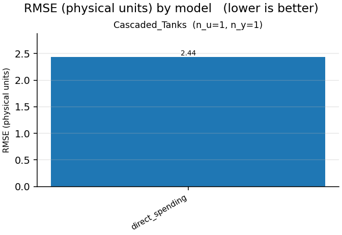

# Nonlinear-benchmarks report

- generated: 2026-11-03 18:12:07
- device: `cpu`  · dtype: `float32`  · seed: 0
- epochs: 3  · trajectory batch: 32  · model dims: d_model=8,d_state=16,n_layers=1
- data protocol: complete native training and validation trajectories; no windows
- live-plot trajectory preview: first 4000 samples
- optimizer: AdamW  · lr: 0.001  · weight decay: 0.0  · gradient clip: 1.0
- model policy: parameter budget `off`  · gamma `auto`  · feedforward `auto`  · residual gates `scalar`

> Parameter matching controls trainable model size, not optimization difficulty. Gain-certified models remain more constrained than the unconstrained LSTM/GRU baselines.

## Summary

## Cascaded_Tanks  (n_u=1, n_y=1)

| model | params | mean RMSE | mean NRMSE | mean fit % | mean R² | best val | best ep | epochs | train s | status |
|---|---|---|---|---|---|---|---|---|---|---|
| direct_spending | 643 | 2.436 | 1.149 | -14.92 | -0.3206 | 1.266 | 3 | 3 | 0.067 | ok |

**Best model (by validation loss): `direct_spending`** — val 1.266 @ epoch 3, validation RMSE 2.436, fit -14.92%.

**Output projection + linear path / transformer / zero-bias / learned gamma (standardized coordinates)**

Gamma (learned): 0.49937495589256287; declared ceiling: 2.0; actual initial beta: 0. Certificate interval: complete trajectory from sample 0, including metric warm-up. The scored suffix retains carried storage. Standardized-coordinate certificates include centering and do not assert a physical-coordinate zero-state bound.

Clipping means the combined NN + linear proposal exceeded the available energy.
