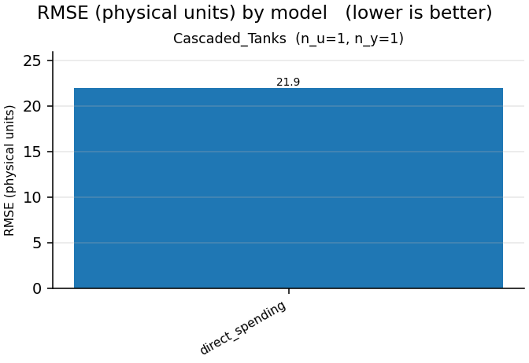

# Nonlinear-benchmarks report

- generated: 2026-11-03 16:33:36
- device: `cpu`  · dtype: `float32`  · seed: 0
- epochs: 10  · trajectory batch: 32  · model dims: d_model=8,d_state=16,n_layers=1
- data protocol: complete native training and validation trajectories; no windows
- live-plot trajectory preview: first 4000 samples
- optimizer: AdamW  · lr: 0.001  · weight decay: 0.0  · gradient clip: 1.0
- model policy: parameter budget `off`  · gamma `auto`  · feedforward `auto`  · residual gates `scalar`

> Parameter matching controls trainable model size, not optimization difficulty. Gain-certified models remain more constrained than the unconstrained LSTM/GRU baselines.

## Summary

## Cascaded_Tanks  (n_u=1, n_y=1)

| model | params | mean RMSE | mean NRMSE | mean fit % | mean R² | best val | best ep | epochs | train s | status |
|---|---|---|---|---|---|---|---|---|---|---|
| direct_spending | 602 | 21.94 | 10.35 | -935 | -106.1 | 102.7 | 10 | 10 | 1.37 | ok |

**Best model (by validation loss): `direct_spending`** — val 102.7 @ epoch 10, validation RMSE 21.94, fit -935%.

**Direct spending / lstm / zero-bias / learned gamma (standardized coordinates)**

Gamma (learned): 9.972662925720215; declared ceiling: 20.0; actual initial beta: 0. Certificate interval: complete trajectory from sample 0, including metric warm-up. The scored suffix retains carried storage. Standardized-coordinate certificates include centering and do not assert a physical-coordinate zero-state bound.

Spending head saturation means ||z|| > 1, not physical output clipping.
