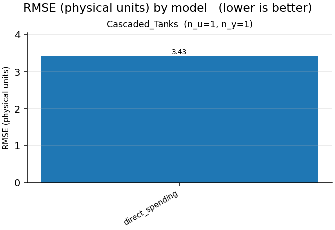

# Nonlinear-benchmarks report

- generated: 2026-10-27 15:56:22
- device: `cpu`  · dtype: `float32`  · seed: 0
- epochs: 1  · trajectory batch: 1  · model dims: d_model=4,d_state=8,n_layers=1
- data protocol: complete native training and validation trajectories; no windows
- live-plot trajectory preview: first 64 samples
- optimizer: AdamW  · lr: 0.001  · weight decay: 0.0  · gradient clip: 1.0
- model policy: parameter budget `off`  · gamma `auto`  · feedforward `auto`  · residual gates `scalar`

> Parameter matching controls trainable model size, not optimization difficulty. Gain-certified models remain more constrained than the unconstrained LSTM/GRU baselines.

## Summary

## Cascaded_Tanks  (n_u=1, n_y=1)

| model | params | mean RMSE | mean NRMSE | mean fit % | mean R² | best val | best ep | epochs | train s | status |
|---|---|---|---|---|---|---|---|---|---|---|
| direct_spending | 13 | 3.433 | 1.62 | -61.95 | -1.623 | 2.515 | 1 | 1 | 0.067 | ok |

**Best model (by validation loss): `direct_spending`** — val 2.515 @ epoch 1, validation RMSE 3.433, fit -61.95%.

**Direct spending / static_mlp / zero-bias (standardized coordinates)**

Fixed gamma: 1.0; actual initial beta: 0. Certificate interval: complete trajectory from sample 0, including metric warm-up. The scored suffix retains carried storage. Standardized-coordinate certificates include centering and do not assert a physical-coordinate zero-state bound.

Spending head saturation means ||z|| > 1, not physical output clipping.

- direct_spending: [training.png](Cascaded_Tanks/direct_spending--static_mlp--zero/training.png)
