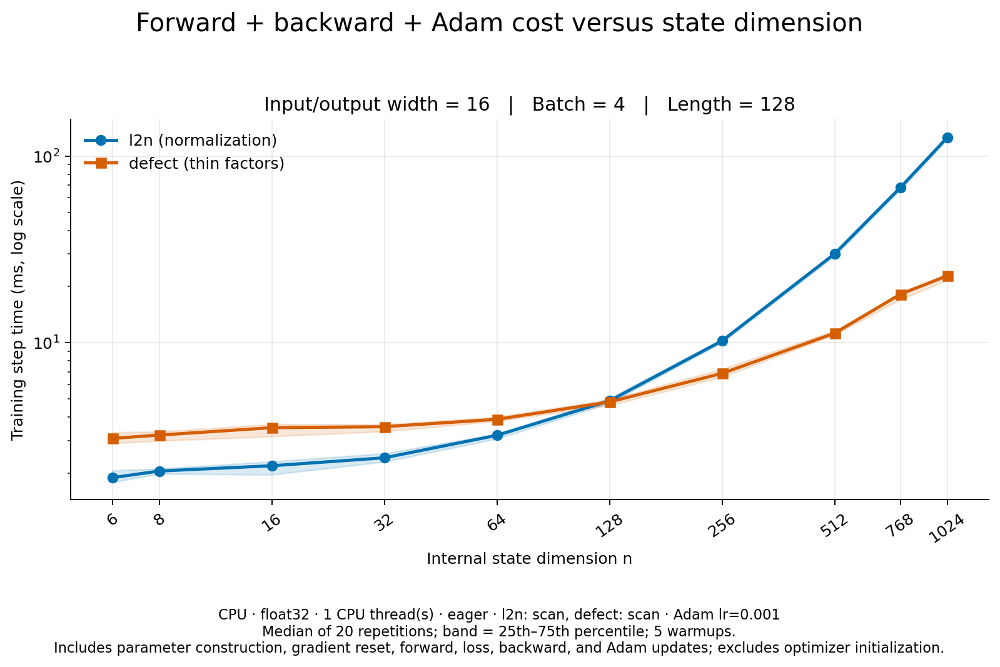

# Complete training-step time versus state dimension

Measured on 2026-10-05 with CPU, float32, one CPU thread, eager execution,
and `scan` for both cells. Input/output width is 16, batch size is 4, and
sequence length is 128 throughout. Adam uses learning rate 0.001, default
betas and epsilon, no weight decay, and `foreach=False` for both cells.

Each timed step includes gradient reset, parameter construction, forward,
mean squared output loss, backward, and an actual Adam update. Optimizer
creation and initial moment-buffer allocation are excluded. Results are
medians of 20 steps after five complete warmup steps; shading shows the
25th–75th percentile, not a confidence interval.



| State dimension | l2n (ms) | Defect (ms) | l2n / defect |
| ---: | ---: | ---: | ---: |
| 6 | 1.895 | 3.074 | 0.62× |
| 8 | 2.056 | 3.204 | 0.64× |
| 16 | 2.194 | 3.508 | 0.63× |
| 32 | 2.420 | 3.552 | 0.68× |
| 64 | 3.194 | 3.891 | 0.82× |
| 128 | 4.886 | 4.820 | 1.01× |
| 256 | 10.235 | 6.857 | 1.49× |
| 512 | 29.950 | 11.249 | 2.66× |
| 768 | 67.889 | 18.222 | 3.73× |
| 1024 | 125.561 | 22.819 | 5.50× |

The cells are nearly tied at 128. Defect is faster at every larger measured
size, reaching 5.50× at 1024. This measures complete implemented cells,
including their different parameter counts and state-coordinate constructions.
It measures per-step cost, rather than time to reach a target accuracy.

A separate forward/backward measurement starts from the same initialization
and uses identical inputs. Complete-step timing uses a fresh cell and updates
its weights through warmup and timed steps. Because weights evolve and timings
vary, subtracting the two independently measured medians does not isolate
optimizer overhead.

Reproduce from the repository root:

```bash
python scripts/compare_defect_vs_normalization.py --state-sweep --include-optimizer \
  --output docs/benchmarks/defect_adam_state_sweep_cpu_2026-10-05.json
```

[Training-step PDF](defect_adam_state_sweep_cpu_2026-10-05-training-step.pdf) ·
[Forward/backward plot](defect_adam_state_sweep_cpu_2026-10-05-forward-backward.png) ·
[Raw samples and metadata](defect_adam_state_sweep_cpu_2026-10-05.json) ·
[CSV](defect_adam_state_sweep_cpu_2026-10-05.csv)
