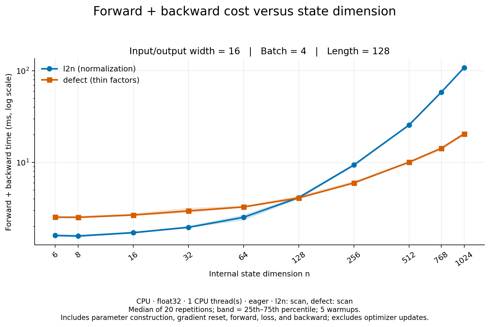

# Forward plus backward time versus state dimension

Measured on 2026-10-05 with CPU, float32, one CPU thread, eager execution,
and `scan` for both cells. Input/output width is 16, batch size is 4, and
sequence length is 128 throughout. State sizes start at 6 because `l2n`
requires an even dimension.

Each measurement includes parameter construction, gradient reset, the sequence
forward pass, a mean squared output loss, and backward. It excludes optimizer
updates. Results are medians of 20 repetitions after five warmups. Shading
shows the 25th–75th percentile, not a confidence interval.



| State dimension | l2n (ms) | Defect (ms) | l2n / defect |
| ---: | ---: | ---: | ---: |
| 6 | 1.598 | 2.534 | 0.63× |
| 8 | 1.573 | 2.520 | 0.62× |
| 16 | 1.715 | 2.673 | 0.64× |
| 32 | 1.958 | 2.964 | 0.66× |
| 64 | 2.520 | 3.271 | 0.77× |
| 128 | 4.132 | 4.105 | 1.01× |
| 256 | 9.384 | 5.979 | 1.57× |
| 512 | 25.618 | 10.069 | 2.54× |
| 768 | 58.428 | 14.302 | 4.09× |
| 1024 | 108.476 | 20.520 | 5.29× |

Normalization is faster for the measured sizes through 64; the cells are
nearly tied at 128. Defect is faster at every larger measured size, reaching
5.29× at 1024. These are timings of the complete implemented cells, including
their different state-coordinate constructions, rather than an isolated
comparison of normalization and square-root formulas. GPU timings and other
widths, batches, or lengths can differ.

Reproduce from the repository root:

```bash
python scripts/compare_defect_vs_normalization.py --state-sweep \
  --output docs/benchmarks/defect_state_sweep_cpu_2026-10-05.json
```

[PDF](defect_state_sweep_cpu_2026-10-05-forward-backward.pdf) ·
[Raw samples and metadata](defect_state_sweep_cpu_2026-10-05.json) ·
[CSV](defect_state_sweep_cpu_2026-10-05.csv)
