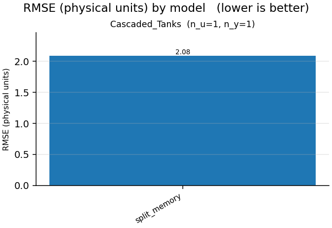

# Nonlinear-benchmarks report

- generated: 2026-10-28 13:58:27
- device: `cpu`  · dtype: `float32`  · seed: 0
- epochs: 1  · trajectory batch: 1  · model dims: d_model=16,d_state=16,n_layers=2
- data protocol: complete native training and validation trajectories; no windows
- live-plot trajectory preview: first 64 samples
- optimizer: AdamW  · lr: 0.003  · weight decay: 0.0  · gradient clip: 1.0
- model policy: parameter budget `off`  · gamma `auto`  · feedforward `auto`  · residual gates `scalar`

> Parameter matching controls trainable model size, not optimization difficulty. Gain-certified models remain more constrained than the unconstrained LSTM/GRU baselines.

## Summary

## Cascaded_Tanks  (n_u=1, n_y=1)

| model | params | mean RMSE | mean NRMSE | mean fit % | mean R² | best val | best ep | epochs | train s | status |
|---|---|---|---|---|---|---|---|---|---|---|
| split_memory | 61 | 2.085 | 0.9834 | 1.664 | 0.03299 | 0.9271 | 1 | 1 | 0.0823 | ok |

**Best model (by validation loss): `split_memory`** — val 0.9271 @ epoch 1, validation RMSE 2.085, fit 1.664%.

- split_memory: [training.png](Cascaded_Tanks/split_memory--recurrent--fixed--scan/training.png)
